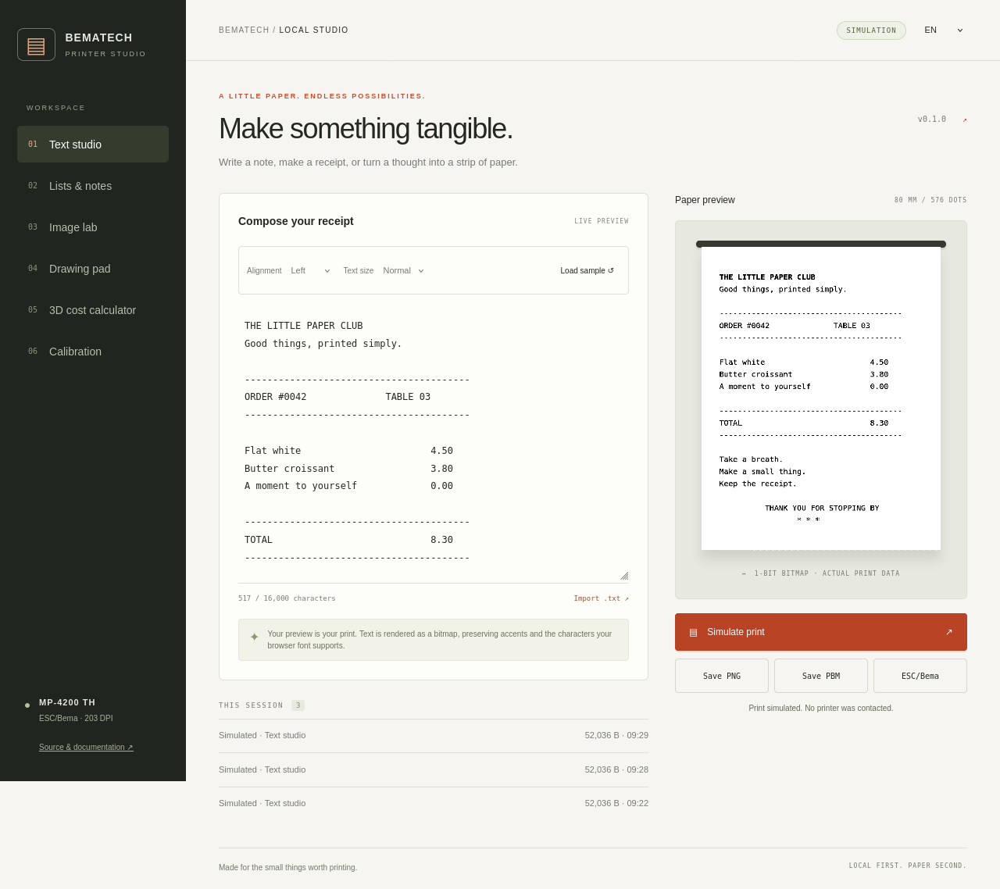
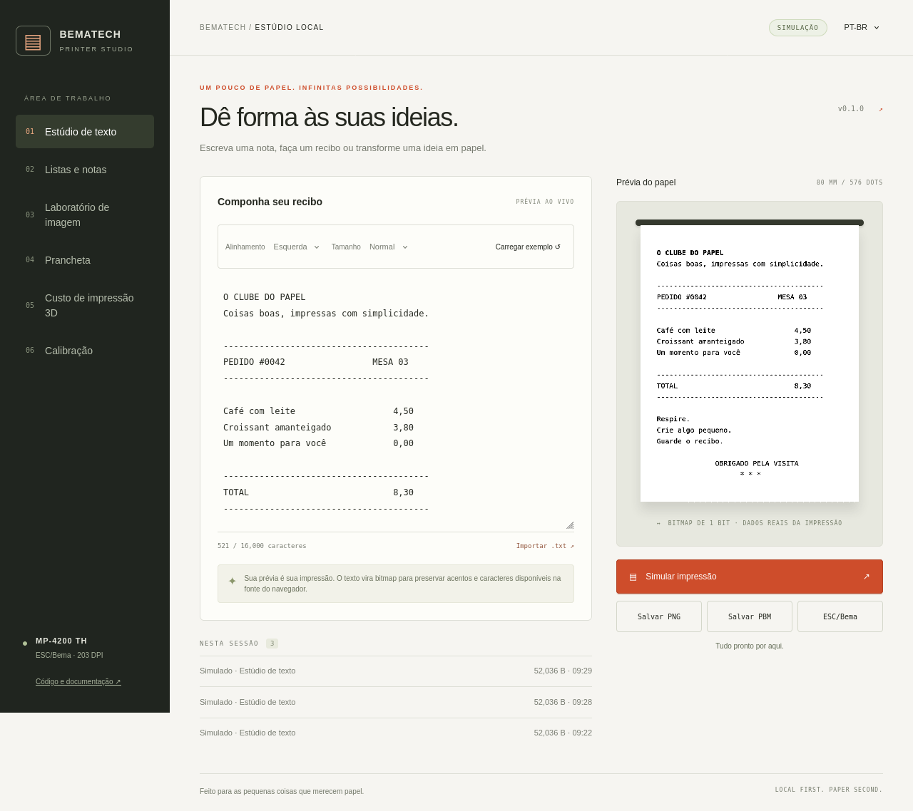
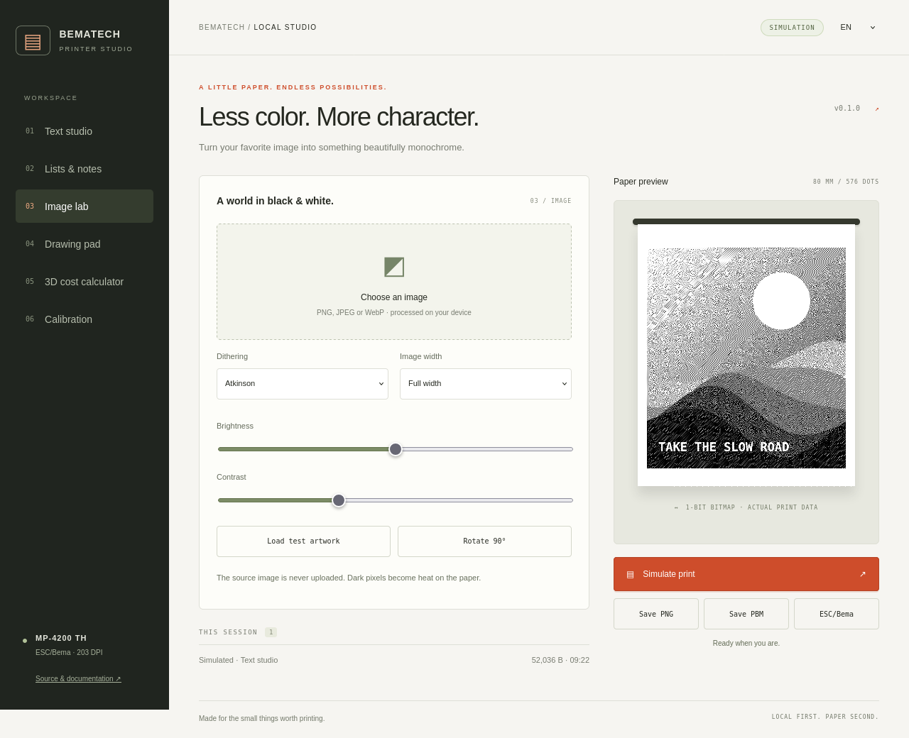
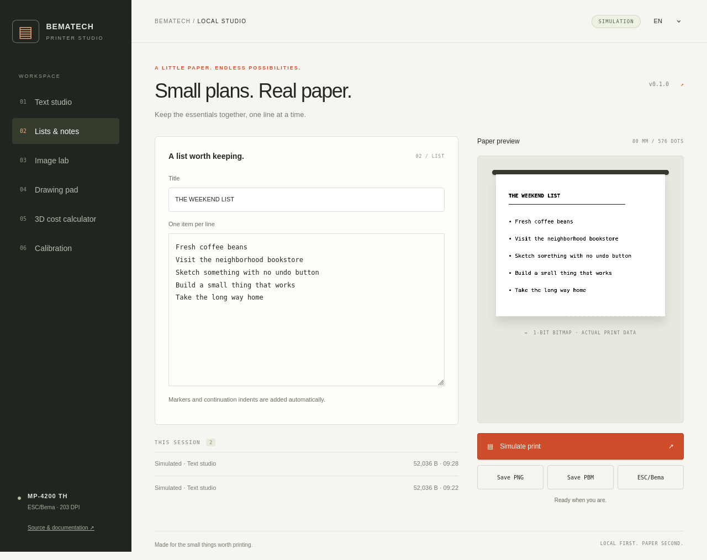
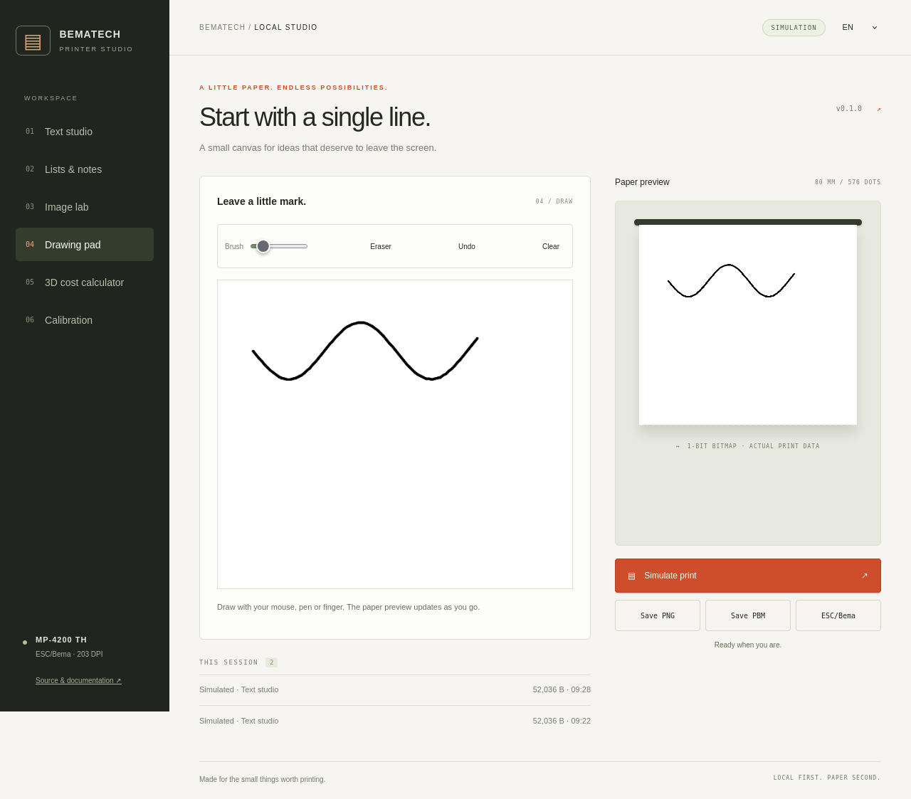
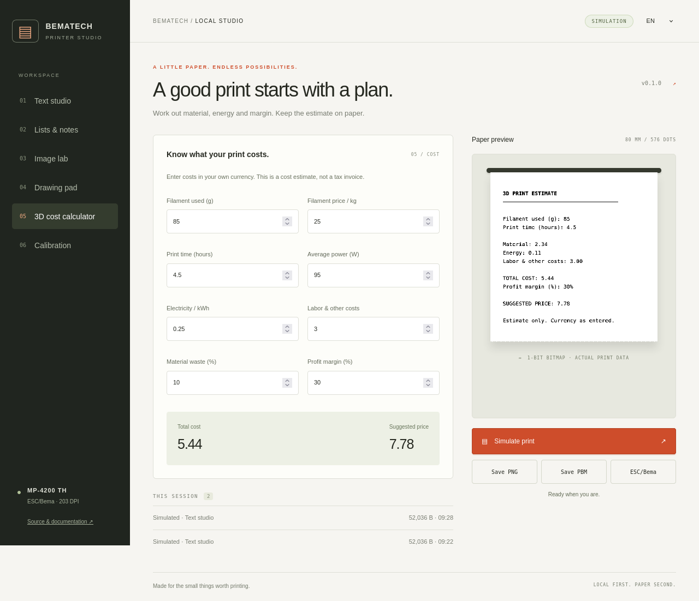
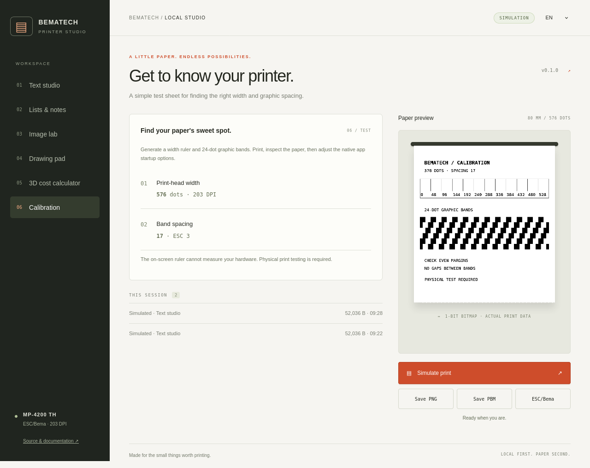
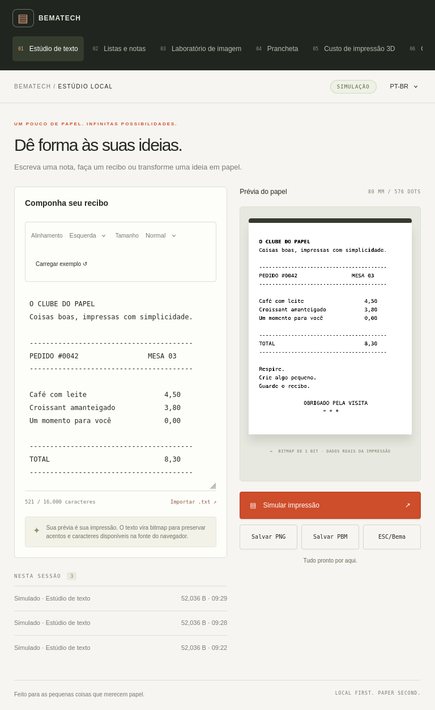
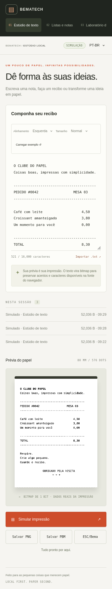

# Application screenshots / Capturas do aplicativo

Real browser captures of the local application running against the C simulation
server. No physical printer was contacted. The hosted playground uses the same
interface with a separate browser-only wrapper.

Capturas reais da aplicação local com o servidor C em simulação. Nenhuma
impressora física foi acionada. A demo usa a mesma interface e um wrapper separado.

## Text studio / Estúdio de texto

## Image lab / Laboratório de imagem

## Lists / Listas

## Drawing / Desenho

## Cost calculator / Calculadora de custos

## Calibration / Calibração

## Responsive layouts / Layouts responsivos

