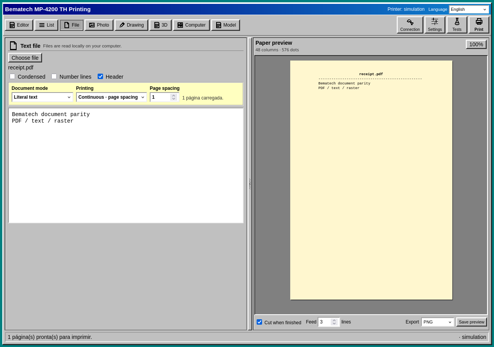
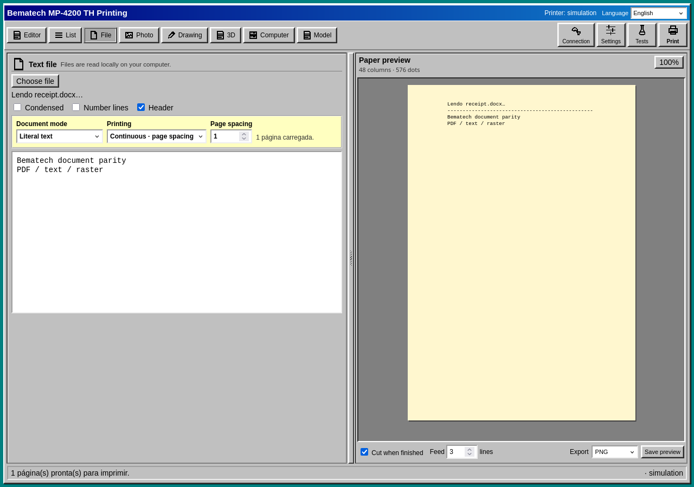
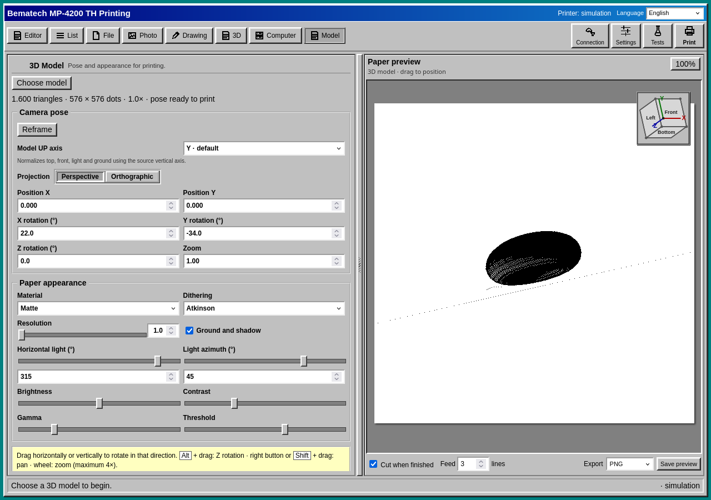
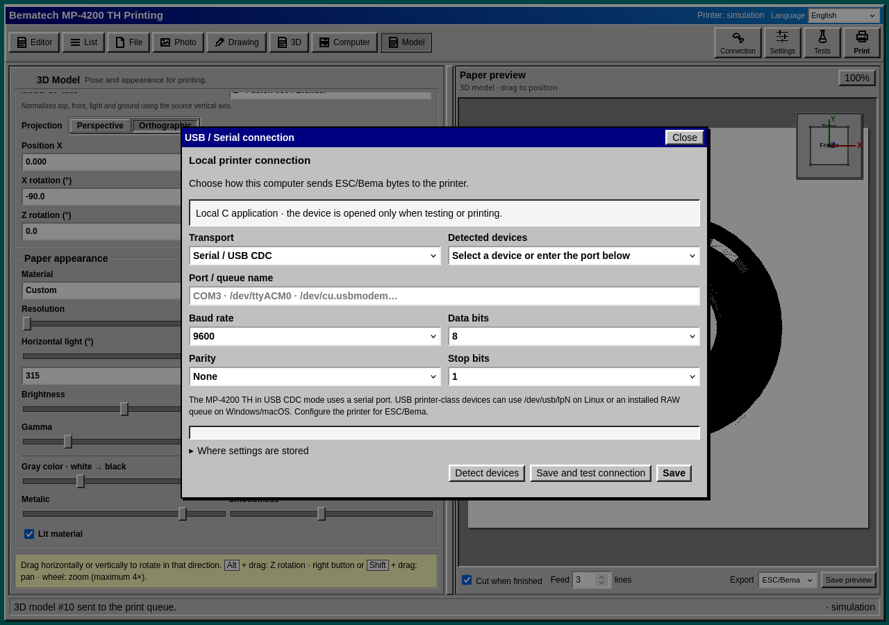

# Application screenshots / Capturas do aplicativo

Real browser captures of the 0.2.0 Windows 98 application running against the
native C server in simulation. No physical printer was contacted. The hosted
playground uses the same interface with a browser-only adapter.

Capturas reais da versão 0.2.0 com servidor C em simulação. Nenhuma impressora
física foi acionada. A demo hospedada usa a mesma interface.

## Original Windows 98 studio / Estúdio Windows 98 original

## Complete tools / Todos os utilitários

## Responsive layouts / Telas responsivas

